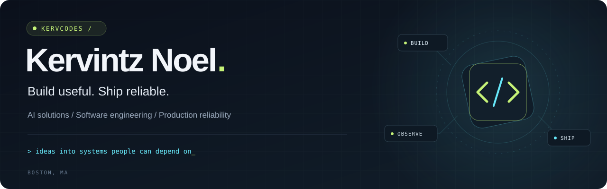

<p align="center">
  <picture>
    
  </picture>
</p>

<h1 align="center">Hey, I'm Kervintz 👋🏾</h1>

<p align="center">
  <strong>I turn messy workflows into useful software, then make sure it holds up.</strong>
</p>

<p align="center">
  <a href="https://kervintznoel.com"></a>
  <a href="https://www.linkedin.com/in/kervintznoel/"></a>
  <a href="mailto:kervintznoel@outlook.com"></a>
</p>

<p align="center">
  Greater Boston · Haitian roots 🇭🇹 · English / Français / Kreyòl
</p>

---

### A builder with a production mindset

I'm a software and reliability engineer focused on **AI solutions and implementation**. My background spans **10+ years in technology**, from enterprise applications and customer support to cloud systems, APIs, and production reliability.

These days, I build AI applications and automation that solve concrete problems. My SRE experience at **Liberty Mutual** shapes how I work: understand the failure modes, make the system observable, and leave the next person a useful runbook.

- **AI that does useful work:** tool calling, structured outputs, and workflow integrations.
- **Software people can depend on:** clear APIs, tests, error handling, and CI/CD.
- **Technical depth with business context:** requirements discovery, troubleshooting, and explaining trade-offs to the people using the system.
- **A legal-tech perspective:** 4+ years across two law firms, working with enterprise applications and the workflows behind them.

> A good demo gets attention. A dependable system earns trust.

### Selected builds

<table>
  <tr>
    <td valign="top" width="50%">
      <h3>01 / AI Digital Twin</h3>
      <p><strong>A conversation with my work.</strong></p>
      <p>An AI assistant grounded in my professional background. It answers questions, captures visitor contact details, and records questions it cannot answer.</p>
      <p>Built with bounded tool calls, rate limiting, structured logging, and graceful provider-error handling.</p>
      <p><code>Python</code> <code>OpenAI</code> <code>Gradio</code> <code>GitHub Actions</code></p>
      <p><a href="https://github.com/kervcodes/Digital-Twin"><strong>Explore the code ↗</strong></a> · <a href="https://kervintznoel.com/twin">Try the assistant ↗</a></p>
    </td>
    <td valign="top" width="50%">
      <h3>02 / Bank Statement Analyzer</h3>
      <p><strong>Your statements. Your machine.</strong></p>
      <p>A local-first desktop app that turns PDF bank statements into cash-flow, spending, and recurring-charge insights.</p>
      <p>Deterministic code computes the numbers. An optional AI layer explains sanitized results after a privacy gateway strips personal information.</p>
      <p><code>Electron</code> <code>React</code> <code>FastAPI</code> <code>SQLite</code></p>
      <p><a href="https://github.com/kervcodes/Bank-Statement-Analyzer"><strong>Explore the code ↗</strong></a></p>
    </td>
  </tr>
</table>

<p align="center">
  <a href="https://kervintznoel.com/projects"><strong>More projects &amp; engineering stories ↗</strong></a>
</p>

### My working stack

<p>
  <code>Python</code> &nbsp; <code>TypeScript</code> &nbsp; <code>React</code> &nbsp; <code>Next.js</code> &nbsp; <code>FastAPI</code> &nbsp; <code>Node.js</code>
</p>

| Where I work | What I use |
| :--- | :--- |
| **AI applications** | OpenAI API, Gemini, tool calling, Python |
| **Web & mobile** | React, Next.js, React Native / Expo, Tailwind CSS |
| **APIs & data** | FastAPI, Node.js / Express, PostgreSQL, Supabase, SQLite |
| **Cloud & delivery** | AWS Lambda, API Gateway, CDK, DynamoDB, GitHub Actions |
| **Reliability & testing** | Datadog, CloudWatch, BigPanda, pytest, Ruff |
| **AI development tools** | Claude Code, Codex |

### How I think about engineering

```text
Understand the workflow → Build the smallest useful system → Verify it
                                  ↑                           ↓
                          Learn from real use ← Ship & observe
```

**Make AI output checkable.** Keep deterministic logic where correctness matters. Validate model output before it drives a workflow.

**Plan for failure.** Timeouts, bounded retries, useful logs, and understandable fallback messages belong in the design.

**Keep the human in view.** The person using the system should understand what happened and what to do next.

<details>
  <summary><strong>A little more about me</strong></summary>

  <br />

  - B.S. in Computer Science from **Boston University**.
  - **Hack.Diversity** Software Engineer Fellow alumnus.
  - Originally from **Haiti**, now based in **Greater Boston**.
  - I speak **English, French, and Haitian Creole**.
  - Exploring retrieval-augmented generation, agents, and MCP through hands-on builds.
  - Most of my project ideas start with: “Why is this process still so painful?”

</details>

---

<h3 align="center">Have a workflow worth fixing?</h3>

<p align="center">
  I'm open to AI solutions, implementation, software, and reliability engineering opportunities.<br />
  <strong>Greater Boston or US remote.</strong>
</p>

<p align="center">
  <a href="mailto:kervintznoel@outlook.com">Let's talk</a> &nbsp; / &nbsp;
  <a href="https://kervintznoel.com">See my work</a> &nbsp; / &nbsp;
  <a href="https://www.linkedin.com/in/kervintznoel/">Connect on LinkedIn</a>
</p>

<p align="center"><sub>Build useful. Ship reliable.</sub></p>
